

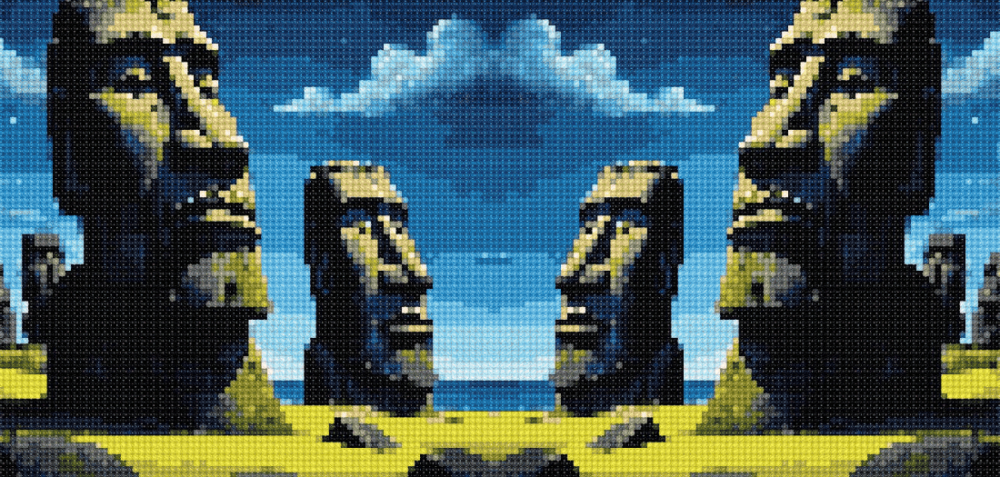

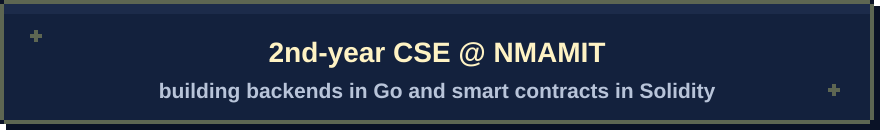

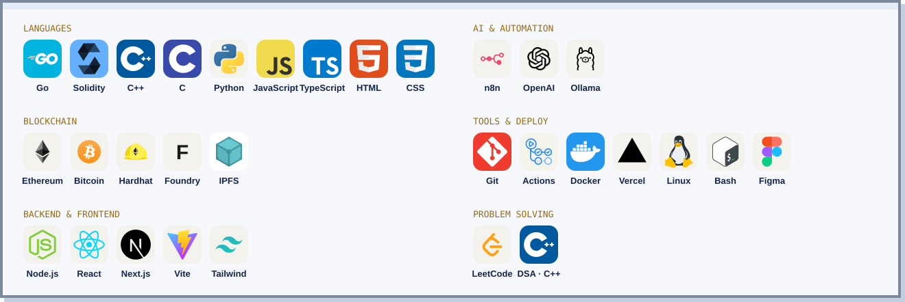

<a href="https://walls-dont-lie.vercel.app">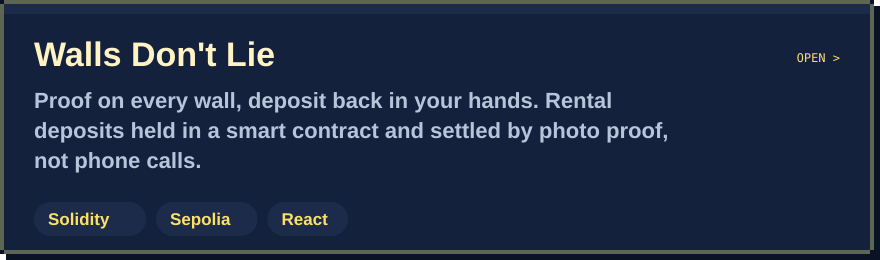</a>
<a href="https://github.com/neilmalvalli-cyber/Provenrely">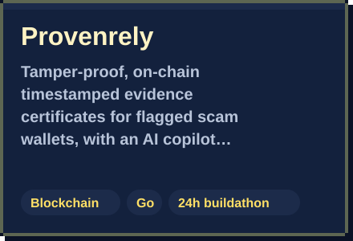</a>
<a href="https://portfolioo-cyan-three.vercel.app/">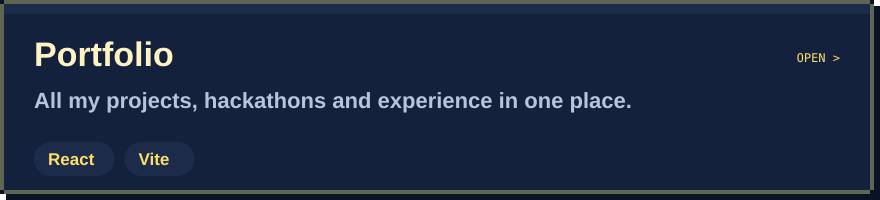</a>

<!--OSS:START-->
<a href="https://github.com/csinitte/nexus-2026/pull/6">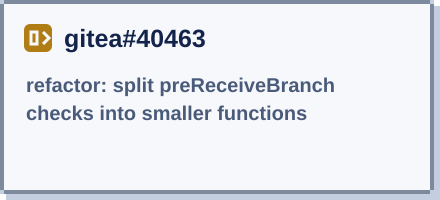</a>

<a href="https://github.com/u-root/gobusybox/pull/187">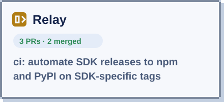</a>
<a href="https://github.com/csinitte/nexus-2026/pull/3">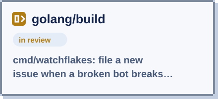</a>

<a href="https://github.com/golang/go/pull/82997">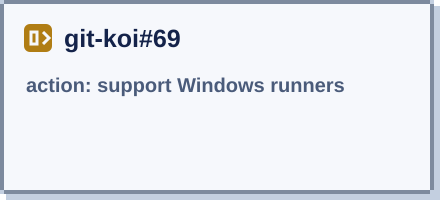</a>
<a href="https://github.com/rajputomsingh/Relay/pull/124">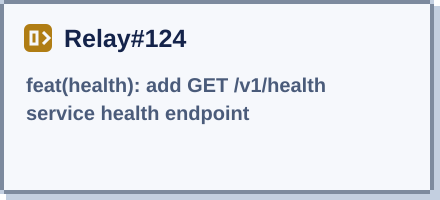</a>
<!--OSS:END-->

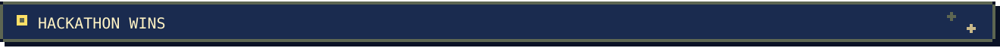
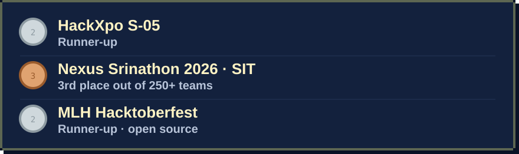

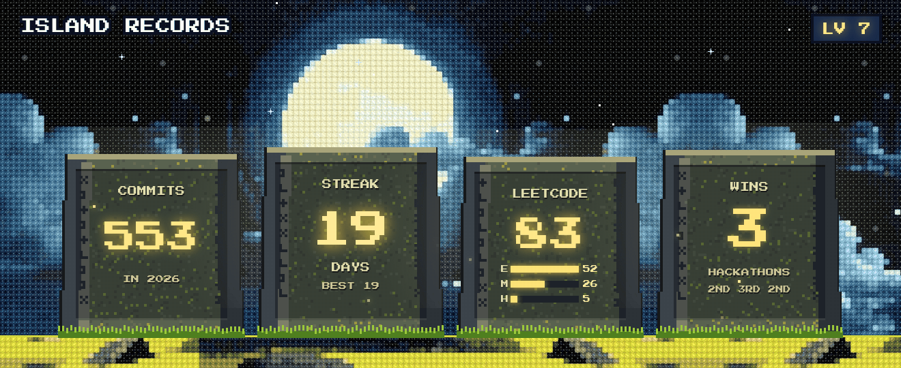

  
  
  
  

