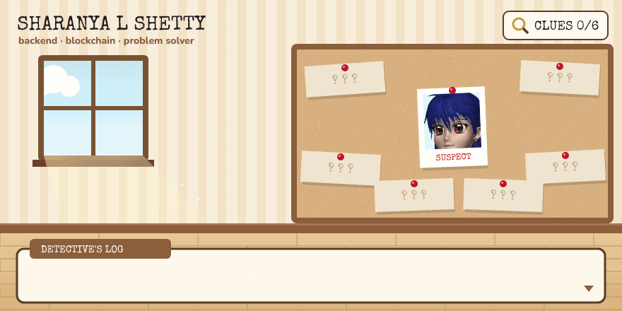
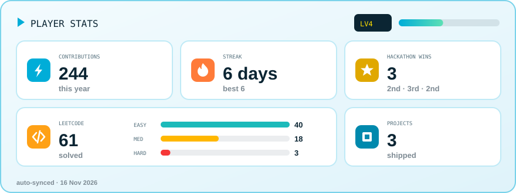

  

  2nd-year CSE @ NMAMIT · building backends in Go and smart contracts in Solidity

  
  
  
  
  
  
  
  
  

## 🧱 Things I've built

**🏠 [Walls Don't Lie](https://walls-dont-lie.vercel.app)** · [repo](https://github.com/sharanyashetty013-droid/Solidity-gang-) 
Proof on every wall, deposit back in your hands. Rental deposits held in a smart contract and settled by photo proof, not phone calls. Solidity · Ethereum Sepolia · React.

**🧾 [Provenrely](https://github.com/neilmalvalli-cyber/Provenrely)** 
Tamper-proof, on-chain timestamped evidence certificates for flagged scam wallets, with an AI copilot that explains results in your language. Built in 24 hours at the MST Blockchain Buildathon.

**🌐 [Portfolio](https://portfolioo-cyan-three.vercel.app/)** 
All my projects in one place.

## 🏆 Hackathon wins

- 🥈 **HackXpo S-05** · runner-up
- 🥉 **Nexus Srinathon 2026 (SIT)** · 3rd place out of 250+ teams
- 🥈 **MLH Hacktoberfest** · runner-up, open source

## 📊 Stats

  

## 🔗 Find me

  
  
  
  

