<a href="https://portfolioo-cyan-three.vercel.app/">
  
</a>

```http
HTTP/1.1 200 OK
Server: sharanya.go
X-Student: 2nd-year CSE @ NMAMIT
X-Focus: backend, blockchain, problem-solving
```

### `→ GET /projects`

| project | what it does |
|---|---|
| ⛓️ **[SatoshiTrace](https://satoshitrace.vercel.app/)** | Bitcoin privacy intelligence tool that shows what the chain thinks is anonymous |
| 🕵️ **[Coin UTXO](https://coinutxo.vercel.app/)** | crypto fraud attribution workspace: multi-hop tracing from scam wallet to exchange, with case reports |
| 🌐 **[Portfolio](https://portfolioo-cyan-three.vercel.app/)** | all my projects in one place |

### `→ GET /open-source`
<sub>auto-synced from GitHub every 6 hours ⟳</sub>

<!--OSS:START-->
- 🟢 **[yalongwastaken/git-koi#69](https://github.com/yalongwastaken/git-koi/pull/69)** · action: support Windows runners
- 🟡 **[golang/go#82997](https://github.com/golang/go/pull/82997)** · encoding/json/v2: detect cycles in self-referential pointer types
- 🟢 **[rajputomsingh/Relay#124](https://github.com/rajputomsingh/Relay/pull/124)** · feat(health): add GET /v1/health service health endpoint

<sub>🟢 merged · 🟡 in review</sub>
<!--OSS:END-->

### `→ GET /hackathons`

| event | result |
|---|---|
| HackXpo S-05 | 🥈 runner-up |
| Nexus Srinathon 2026 (SIT) | 🏅 consolation prize · top 30 of 250+ |
| MLH Hacktoberfest | 🥈 runner-up · open source |

### `→ GET /stack`

<p align="left">
  
  
  
  
  
  
  
  
  
</p>

### `→ GET /ask-me-about`

```json
["blockchain forensics", "Go APIs", "DSA", "public speaking 🎤"]
```
<sub>fun fact: I trace stolen crypto for fun and call it a hobby</sub>

### `→ GET /metrics`

<p align="center">
  
</p>
<p align="center">
  
</p>
<p align="center">
  
</p>

### `→ GET /contact`

<p align="left">
  <a href="https://linkedin.com/in/sharanya-l-shetty-81156a424"></a>
  <a href="https://leetcode.com/u/sharanya_shetty01/"></a>
  <a href="mailto:sharanyashetty013@gmail.com"></a>
  <a href="https://www.instagram.com/shetty_sharanyyya/"></a>
</p>

<sub>`// the server up top is generated by a Go program in this repo (cmd/gen) and redeployed by a GitHub Action`</sub>
